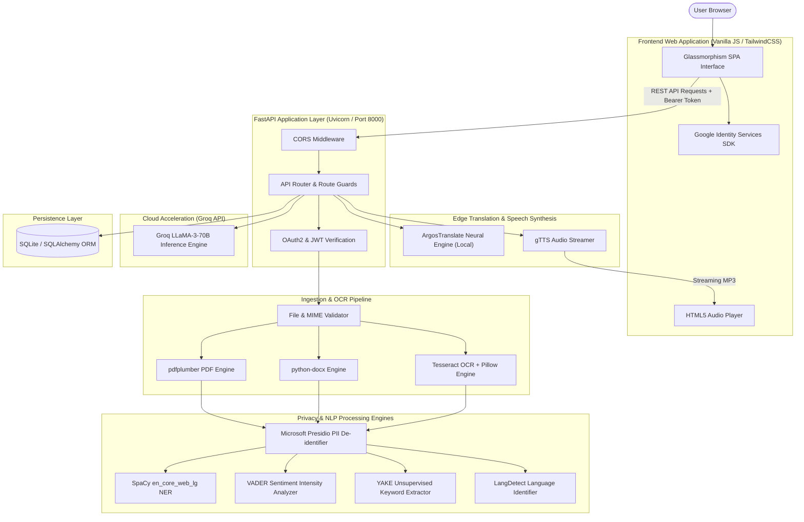
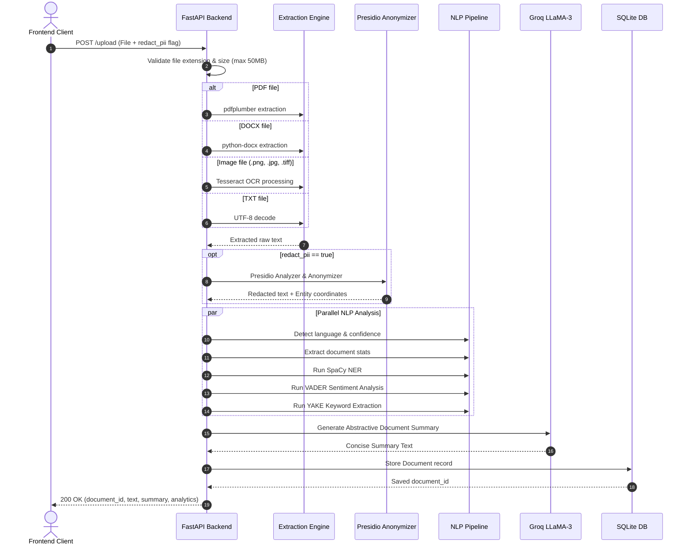
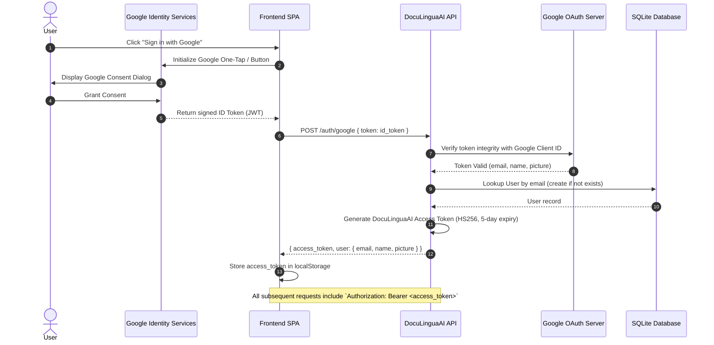
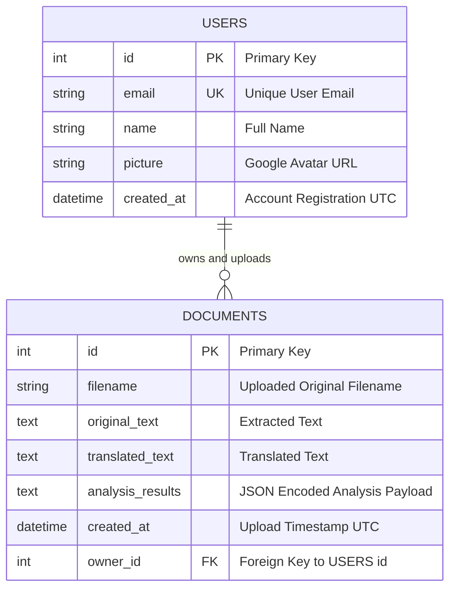

# DocuLinguaAI 📄🌐🤖

> **Enterprise-Grade Intelligent Multi-Lingual Document Understanding, Neural Translation, and Contextual AI Analytics Platform**

[](https://fastapi.tiangolo.com)
[](https://www.python.org/)
[](https://groq.com/)
[](https://github.com/tesseract-ocr/tesseract)
[](https://github.com/microsoft/presidio)
[](https://spacy.io/)
[](https://tailwindcss.com/)
[](https://opensource.org/licenses/MIT)

---

## 📑 Table of Contents

- [1. Executive Summary](#1-executive-summary)
- [2. System Architecture](#2-system-architecture)
  - [2.1 High-Level Architecture](#21-high-level-architecture)
  - [2.2 Ingestion & Processing Pipeline](#22-ingestion--processing-pipeline)
  - [2.3 Authentication & Authorization Lifecycle](#23-authentication--authorization-lifecycle)
- [3. Key Features & Capabilities](#3-key-features--capabilities)
  - [3.1 Multi-Format Document Ingestion](#31-multi-format-document-ingestion)
  - [3.2 Enterprise Privacy & PII Redaction](#32-enterprise-privacy--pii-redaction)
  - [3.3 Deep Linguistic & NLP Analytics](#33-deep-linguistic--nlp-analytics)
  - [3.4 Offline Neural Machine Translation](#34-offline-neural-machine-translation)
  - [3.5 Groq LLaMA-3 Document Intelligence](#35-groq-llama-3-document-intelligence)
  - [3.6 Accessibility & Streaming Text-to-Speech](#36-accessibility--streaming-text-to-speech)
  - [3.7 In-Document Contextual Search](#37-in-document-contextual-search)
  - [3.8 Interactive Knowledge Evaluation (AI Quiz)](#38-interactive-knowledge-evaluation-ai-quiz)
  - [3.9 Multi-Tenant Document History & Persistence](#39-multi-tenant-document-history--persistence)
- [4. Technology Stack Matrix](#4-technology-stack-matrix)
- [5. Database Architecture & Schema](#5-database-architecture--schema)
  - [5.1 Entity Relationship Diagram](#51-entity-relationship-diagram)
  - [5.2 Model Definitions](#52-model-definitions)
  - [5.3 Analysis Results JSON Schema](#53-analysis-results-json-schema)
- [6. Complete REST API Reference](#6-complete-rest-api-reference)
  - [6.1 Authentication Endpoints](#61-authentication-endpoints)
  - [6.2 Document Ingestion & Processing](#62-document-ingestion--processing)
  - [6.3 Translation & Linguistics](#63-translation--linguistics)
  - [6.4 AI Question & Answering](#64-ai-question--answering)
  - [6.5 AI Quiz Generation](#65-ai-quiz-generation)
  - [6.6 In-Document Search](#66-in-document-search)
  - [6.7 Text-to-Speech Audio Stream](#67-text-to-speech-audio-stream)
  - [6.8 Document History & Management](#68-document-history--management)
- [7. Installation & Setup Guide](#7-installation--setup-guide)
  - [7.1 System Prerequisites](#71-system-prerequisites)
  - [7.2 Installing Tesseract OCR](#72-installing-tesseract-ocr)
  - [7.3 Environment Setup (PowerShell / Bash)](#73-environment-setup-powershell--bash)
  - [7.4 Installing Python Dependencies](#74-installing-python-dependencies)
  - [7.5 Downloading Machine Learning Models](#75-downloading-machine-learning-models)
- [8. Configuration & Environment Variables](#8-configuration--environment-variables)
  - [8.1 Environment File (.env)](#81-environment-file-env)
  - [8.2 Google OAuth2 Setup Walkthrough](#82-google-oauth2-setup-walkthrough)
  - [8.3 Groq Cloud API Key Setup](#83-groq-cloud-api-key-setup)
- [9. Running the Application](#9-running-the-application)
  - [9.1 Starting the FastAPI Backend](#91-starting-the-fastapi-backend)
  - [9.2 Serving the Modern Frontend](#92-serving-the-modern-frontend)
  - [9.3 Interactive Swagger / OpenAPI Documentation](#93-interactive-swagger--openapi-documentation)
- [10. Frontend User Interface Guide](#10-frontend-user-interface-guide)
- [11. Privacy, Security & Compliance](#11-privacy-security--compliance)
- [12. Production Deployment & DevOps](#12-production-deployment--devops)
  - [12.1 Docker Containerization](#121-docker-containerization)
  - [12.2 Docker Compose Multi-Service Setup](#122-docker-compose-multi-service-setup)
  - [12.3 Nginx Reverse Proxy Configuration](#123-nginx-reverse-proxy-configuration)
- [13. Troubleshooting & FAQ](#13-troubleshooting--faq)
- [14. Directory Structure](#14-directory-structure)
- [15. Contributing Guidelines](#15-contributing-guidelines)
- [16. Authors & Acknowledgments](#16-authors--acknowledgments)
- [17. License](#17-license)

---

## 1. Executive Summary

In today's global enterprise landscape, knowledge workers and organizations are flooded with vast quantities of unstructured, multi-lingual documents: legal agreements, medical reports, financial disclosures, technical specifications, and scanned invoices. Extracting actionable insights from these documents poses significant challenges:

1. **Format Fragmentation:** Text is trapped in disparate formats—PDFs, Word documents, text files, or low-resolution scans and mobile camera captures.
2. **Language Barriers:** Cross-border business requires real-time, accurate translation without transmitting confidential corporate data to public translation clouds.
3. **Privacy & Compliance Violations (GDPR / HIPAA):** Sharing raw documents containing Personally Identifiable Information (PII) exposes companies to severe legal and financial penalties.
4. **Information Overload:** Reviewing 100-page documents for specific answers or key metrics requires hours of human labor.

**DocuLinguaAI** solves these problems with a unified, secure, local-first intelligence engine. Built on **FastAPI**, **Groq LLaMA-3 (70B)**, **Microsoft Presidio**, **SpaCy**, and **ArgosTranslate**, DocuLinguaAI transforms raw files into structured intelligence, anonymizes sensitive records on-the-fly, enables offline machine translation across 11+ languages, generates executive summaries, creates comprehension quizzes, provides context-grounded Q&A, and streams synthesized audio speech for high accessibility.

---

## 2. System Architecture

DocuLinguaAI employs a modern, decoupled client-server architecture designed for high throughput, asynchronous concurrency, and privacy-preserving data isolation.

### 2.1 High-Level Architecture



### 2.2 Ingestion & Processing Pipeline

The ingestion pipeline executes an asynchronous multi-stage transformation:



### 2.3 Authentication & Authorization Lifecycle

DocuLinguaAI enforces enterprise-grade identity management using **Google OAuth 2.0** combined with stateless **JSON Web Tokens (JWT)**:



---

## 3. Key Features & Capabilities

### 3.1 Multi-Format Document Ingestion

DocuLinguaAI handles diverse digital and physical document formats without requiring external conversion utilities:

| Format Category | Supported Extensions | Processing Technology | Capabilities |
| :--- | :--- | :--- | :--- |
| **PDF Documents** | `.pdf` | `pdfplumber` | Multi-page layout parsing, whitespace preservation, tabular text extraction. |
| **Word Documents** | `.docx` | `python-docx` | Paragraph extraction, structural hierarchy maintenance. |
| **Scanned Images** | `.png`, `.jpg`, `.jpeg`, `.bmp`, `.tiff` | `pytesseract` + `Pillow` (PIL) | Optical Character Recognition (OCR), adaptive thresholding, RGB-to-grayscale processing. |
| **Plain Text** | `.txt` | Native Python I/O | Multi-encoding error tolerance with UTF-8 normalization. |

### 3.2 Enterprise Privacy & PII Redaction

Data privacy is built into the ingestion layer using **Microsoft Presidio (Analyzer & Anonymizer Engine)**:
- **Detection Capabilities:** Identifies sensitive Personally Identifiable Information, including:
  - Phone Numbers (`PHONE_NUMBER`)
  - Credit Card Numbers (`CREDIT_CARD`)
  - Email Addresses (`EMAIL_ADDRESS`)
  - Physical Addresses & Locations (`LOCATION`)
  - Personal Names (`PERSON`)
  - IP Addresses (`IP_ADDRESS`)
  - Identification Numbers (SSN, National IDs)
- **Granular Redaction Operators:**
  - Phone numbers are masked (`*` substitution with format preservation).
  - Credit cards are masked to the last 4 digits.
  - General entities are replaced with deterministic markers (`[REDACTED]`).
- **Audit Coordinates:** Preserves original entity offsets (start character, end character, confidence score) for administrative review.

### 3.3 Deep Linguistic & NLP Analytics

Every processed document is enriched with multifaceted computational linguistics:
- **Language Detection:** Uses `langdetect` to identify the document's language and calculates a normalized Bayesian confidence score.
- **Lexical Statistics:** Word counts, sentence counts, and character lengths.
- **Named Entity Recognition (NER):** Driven by SpaCy's `en_core_web_lg` transformer-grade statistical model. Extracts and tags entities (`PERSON`, `ORG`, `GPE`, `DATE`, `MONEY`, `FAC`, `PRODUCT`, `EVENT`) with character indices for frontend visual highlighting.
- **Sentiment & Polarity Analysis:** Utilizes `vaderSentiment` to compute granular valence scores: Positive, Negative, Neutral, and the overall normalized Compound score ($-1.0$ to $+1.0$).
- **Unsupervised Keyword Extraction:** Employs **YAKE** (Yet Another Keyword Extractor) to isolate high-value terms and phrases using text-feature heuristics (casing, word frequency, word position, context), ranked with deduplication limit $0.9$.

### 3.4 Offline Neural Machine Translation

Translation is executed entirely on the local server without sending data to third-party translation APIs:
- Powered by **ArgosTranslate** (open-source neural machine translation library built on OpenNMT and CTranslate2).
- **On-Demand Package Resolution:** Checks the local model registry; if a language pair (e.g., `es` $\to$ `en`) is not installed, the engine queries the package repository, downloads the neural package, installs it into memory, and executes translation.
- **Supported Languages:** English (`en`), Spanish (`es`), French (`fr`), German (`de`), Italian (`it`), Portuguese (`pt`), Russian (`ru`), Japanese (`ja`), Korean (`ko`), Chinese (`zh`), Arabic (`ar`).

### 3.5 Groq LLaMA-3 Document Intelligence

High-speed generative AI inference is offloaded to Groq's Tensor Streaming Processors (LPU) using the **LLaMA-3-70B** model:
- **Zero-Shot Summarization:** Distills dense legal, financial, or technical documents into structured executive summaries without boilerplate introductions.
- **Context-Grounded Q&A (RAG-Lite):** Allows users to query the document in natural language. The system grounds the LLM strictly within the document's context, mitigating hallucinations.
- **Context Fallback:** Intelligently switches between translated text and original text as the contextual basis for queries.

### 3.6 Accessibility & Streaming Text-to-Speech

Ensures accessibility compliance and multi-modal consumption:
- Uses **Google Text-to-Speech (gTTS)** to synthesize human-grade audio directly from document content.
- Supports streaming of both the **Full Document Text** and the **AI Summary**.
- Returns a binary `audio/mpeg` stream consumed by the browser's native audio interface without storing temporary audio files on disk.

### 3.7 In-Document Contextual Search

- High-performance regex query engine.
- Extracts up to 10 contextual occurrences with a **70-character bounding window** before and after the match.
- Performs case-insensitive matching across either translated text or original content.

### 3.8 Interactive Knowledge Evaluation (AI Quiz)

- Generates interactive, 5-question multiple-choice quizzes directly from document contents.
- Strict JSON schema validation enforced through prompt engineering.
- Real-time client-side scoring with explanations and answer reveals.

### 3.9 Multi-Tenant Document History & Persistence

- Every processed document is persisted to **SQLite** via **SQLAlchemy**.
- Strict tenant isolation ensures users can only access documents linked to their `owner_id`.
- Full cascading delete support for user privacy and data retention management.

---

## 4. Technology Stack Matrix

| Layer | Technology | Version | Purpose |
| :--- | :--- | :--- | :--- |
| **Web Framework** | FastAPI | `0.116.1` | Asynchronous REST API routing, Pydantic validation, dependency injection. |
| **ASGI Server** | Uvicorn | `0.35.0` | High-performance asynchronous HTTP/WebSocket server. |
| **LLM Inference** | Groq Python SDK | `0.31.0` | Ultra-fast LPU inference for LLaMA-3-70B (`llama3-70b-8192`). |
| **OCR Engine** | Tesseract OCR | `5.x` | Deep learning LSTM-based optical character recognition. |
| **Python OCR Wrapper** | Pytesseract | `0.3.10` | Python bindings for Tesseract executable. |
| **PDF Extraction** | pdfplumber | `0.11.0` | Visual layout-aware PDF text extraction. |
| **DOCX Extraction** | python-docx | `1.1.2` | OpenXML Word document parsing and paragraph traversal. |
| **Image Processing** | Pillow (PIL) | `10.4.0` | Image conversion, resizing, grayscale channel manipulation. |
| **PII Anonymization** | Microsoft Presidio | `2.2.359` | Analyzer and Anonymizer engines for privacy compliance. |
| **NLP Core** | SpaCy (`en_core_web_lg`) | `3.8.7` | Large statistical pipeline for tokenization, POS, and NER. |
| **Sentiment Analysis** | VADER Sentiment | `3.3.2` | Rule-based valence analysis calibrated for English texts. |
| **Keyword Extraction** | YAKE | `0.6.0` | Unsupervised statistical keyphrase and keyword extractor. |
| **Language Detection** | langdetect | `1.0.9` | Naive Bayes probabilistic language classifier. |
| **Machine Translation**| ArgosTranslate | `1.9.6` | Offline neural machine translation based on CTranslate2. |
| **Speech Synthesis** | gTTS | `2.5.4` | Google Text-to-Speech audio serialization. |
| **Database ORM** | SQLAlchemy | `2.0.43` | Object-Relational Mapping, connection pooling, and migrations. |
| **Database Engine** | SQLite3 | `3.x` | Embedded relational database with thread safety (`check_same_thread=False`). |
| **Authentication** | Google Auth & python-jose | `2.40.3` / `3.5.0` | OAuth2 id_token validation and JWT signing (HS256). |
| **Frontend Styling** | Tailwind CSS | `3.x CDN` | Responsive utility-first modern Glassmorphism UI. |
| **Frontend Icons** | Lucide Icons | Latest | Modern, clean vector icon set. |

---

## 5. Database Architecture & Schema

### 5.1 Entity Relationship Diagram



### 5.2 Model Definitions

#### `User` Entity
- `id` (Integer, Primary Key): Unique internal user identifier.
- `email` (String, Unique, Index): Google account email.
- `name` (String): User's display name.
- `picture` (String): URL pointing to Google avatar image.
- `created_at` (DateTime): UTC timestamp when user first logged in.
- `documents` (Relationship): One-to-many relationship with `Document` (`cascade="all, delete-orphan"`).

#### `Document` Entity
- `id` (Integer, Primary Key): Unique document identifier.
- `filename` (String, Index): Name of the uploaded file.
- `original_text` (Text): The raw extracted text (or PII-redacted text if selected).
- `translated_text` (Text, Nullable): Cached translated text from ArgosTranslate.
- `analysis_results` (Text): Serialized JSON payload containing linguistic, statistical, and AI analysis.
- `created_at` (DateTime): UTC timestamp of upload.
- `owner_id` (Integer, Foreign Key): Reference to `users.id`.

### 5.3 Analysis Results JSON Schema

The `analysis_results` column stores a structured JSON document:

```json
{
  "language_detection": {
    "language": "en",
    "confidence": 0.999
  },
  "statistics": {
    "word_count": 542,
    "sentence_count": 28,
    "character_count": 3480
  },
  "summary": "This document outlines the quarterly financial performance...",
  "entities": [
    {
      "text": "Acme Corporation",
      "label": "ORG",
      "start": 12,
      "end": 28
    }
  ],
  "sentiment": {
    "neg": 0.02,
    "neu": 0.85,
    "pos": 0.13,
    "compound": 0.7425
  },
  "keywords": [
    {
      "term": "quarterly revenue",
      "score": 0.045
    }
  ],
  "pii_results": [
    {
      "text": "555-0199",
      "type": "PHONE_NUMBER",
      "score": 0.85,
      "start": 142,
      "end": 150
    }
  ]
}
```

---

## 6. Complete REST API Reference

All protected endpoints require the HTTP header:
```http
Authorization: Bearer <your_jwt_access_token>
```

### 6.1 Authentication Endpoints

#### `POST /auth/google`
Authenticates a user via Google Identity Services, creates an account if none exists, and issues an access JWT.

- **Authentication:** Public
- **Request Body:** `application/json`
  ```json
  {
    "token": "<google_id_token_jwt>"
  }
  ```
- **Response `200 OK`:**
  ```json
  {
    "access_token": "eyJhbGciOiJIUzI1NiIsIn...",
    "token_type": "bearer",
    "user": {
      "email": "user@example.com",
      "name": "John Doe",
      "picture": "https://lh3.googleusercontent.com/..."
    }
  }
  ```
- **Error Codes:** `401 Unauthorized` (Invalid ID token), `500 Internal Server Error` (Unconfigured authentication).

```bash
curl -X POST "http://127.0.0.1:8000/auth/google" \
     -H "Content-Type: application/json" \
     -d '{"token": "YOUR_GOOGLE_ID_TOKEN"}'
```

---

#### `GET /me`
Retrieves the profile of the currently authenticated user.

- **Authentication:** Bearer Token
- **Response `200 OK`:**
  ```json
  {
    "id": 1,
    "email": "user@example.com",
    "name": "John Doe",
    "picture": "https://lh3.googleusercontent.com/..."
  }
  ```

```bash
curl -X GET "http://127.0.0.1:8000/me" \
     -H "Authorization: Bearer YOUR_ACCESS_TOKEN"
```

---

### 6.2 Document Ingestion & Processing

#### `POST /upload`
Uploads a document, extracts text via format-specific handlers (or OCR), executes PII de-identification, runs the complete NLP analytics suite, generates an AI summary with Groq, and stores the record in SQLite.

- **Authentication:** Bearer Token
- **Content-Type:** `multipart/form-data`
- **Form Parameters:**
  - `file`: Binary file (`.pdf`, `.docx`, `.txt`, `.png`, `.jpg`, `.jpeg`, `.bmp`, `.tiff`). Max size: 50MB.
  - `redact_pii`: Boolean (`true` or `false`). If `true`, masks sensitive personal information before analysis.
- **Response `200 OK`:**
  ```json
  {
    "document_id": 12,
    "filename": "Q3_Report.pdf",
    "original_text": "...",
    "language_detection": { "language": "en", "confidence": 0.999 },
    "statistics": { "word_count": 450, "sentence_count": 22, "character_count": 3100 },
    "summary": "The Q3 report demonstrates a 14% growth in operating revenue...",
    "entities": [ ... ],
    "sentiment": { "neg": 0.0, "neu": 0.88, "pos": 0.12, "compound": 0.65 },
    "keywords": [ ... ],
    "pii_results": [ ... ],
    "message": "Document processed successfully"
  }
  ```
- **Error Codes:** `400 Bad Request` (Invalid format/empty file), `413 Payload Too Large` (> 50MB), `500 Internal Server Error` (Extraction/OCR failure).

```bash
curl -X POST "http://127.0.0.1:8000/upload" \
     -H "Authorization: Bearer YOUR_ACCESS_TOKEN" \
     -F "file=@/path/to/contract.pdf" \
     -F "redact_pii=true"
```

---

### 6.3 Translation & Linguistics

#### `POST /translate/{document_id}`
Translates a previously processed document into the specified target language using ArgosTranslate.

- **Authentication:** Bearer Token
- **Path Parameter:** `document_id` (Integer)
- **Form Parameter:** `target_lang` (String, e.g. `es`, `fr`, `de`, `it`, `pt`, `ru`, `ja`, `ko`, `zh`, `ar`)
- **Response `200 OK`:**
  ```json
  {
    "translated_text": "El informe del tercer trimestre demuestra un crecimiento del 14%..."
  }
  ```
- **Error Codes:** `404 Not Found` (Document does not exist or unauthorized), `500 Internal Server Error` (Argos package installation/inference failure).

```bash
curl -X POST "http://127.0.0.1:8000/translate/12" \
     -H "Authorization: Bearer YOUR_ACCESS_TOKEN" \
     -F "target_lang=es"
```

---

### 6.4 AI Question & Answering

#### `POST /qa/{document_id}`
Answers user questions grounded strictly in the context of the document using Groq LLaMA-3.

- **Authentication:** Bearer Token
- **Path Parameter:** `document_id` (Integer)
- **Form Parameter:** `question` (String, e.g. "What was the total net margin in Q3?")
- **Response `200 OK`:**
  ```json
  {
    "answer": "According to the document, the total net margin in Q3 reached 22.4%, up 3% from Q2."
  }
  ```
- **Error Codes:** `404 Not Found`, `503 Service Unavailable` (Groq API key not configured).

```bash
curl -X POST "http://127.0.0.1:8000/qa/12" \
     -H "Authorization: Bearer YOUR_ACCESS_TOKEN" \
     -F "question=What were the key risks identified?"
```

---

### 6.5 AI Quiz Generation

#### `POST /quiz/{document_id}`
Generates an interactive 5-question multiple choice quiz testing comprehension of key points.

- **Authentication:** Bearer Token
- **Path Parameter:** `document_id` (Integer)
- **Response `200 OK`:**
  ```json
  {
    "quiz": [
      {
        "question": "What was the primary driver of growth in Q3?",
        "options": [
          "Expansion into European markets",
          "Reduction in manufacturing overhead",
          "Enterprise subscription renewals",
          "Divestiture of legacy assets"
        ],
        "correct_answer": "Enterprise subscription renewals"
      }
    ]
  }
  ```

```bash
curl -X POST "http://127.0.0.1:8000/quiz/12" \
     -H "Authorization: Bearer YOUR_ACCESS_TOKEN"
```

---

### 6.6 In-Document Search

#### `POST /search/{document_id}`
Performs a fast regex search across the document text and returns snippets with context.

- **Authentication:** Bearer Token
- **Path Parameter:** `document_id` (Integer)
- **Form Parameter:** `query` (String)
- **Response `200 OK`:**
  ```json
  {
    "results": [
      {
        "snippet": "...operating profit for the period exceeded initial projections by 14% across all regions..."
      }
    ]
  }
  ```

```bash
curl -X POST "http://127.0.0.1:8000/search/12" \
     -H "Authorization: Bearer YOUR_ACCESS_TOKEN" \
     -F "query=operating profit"
```

---

### 6.7 Text-to-Speech Audio Stream

#### `POST /tts/{document_id}`
Synthesizes speech from document text or its AI summary, streaming MP3 audio directly.

- **Authentication:** Bearer Token
- **Path Parameter:** `document_id` (Integer)
- **Form Parameter:** `text_type` (`"original"` or `"summary"`)
- **Response `200 OK`:** Binary audio stream (`media_type="audio/mpeg"`)

```bash
curl -X POST "http://127.0.0.1:8000/tts/12" \
     -H "Authorization: Bearer YOUR_ACCESS_TOKEN" \
     -F "text_type=summary" \
     --output summary_audio.mp3
```

---

### 6.8 Document History & Management

#### `GET /documents/history`
Returns the 10 most recently processed documents for the authenticated user.

- **Authentication:** Bearer Token
- **Response `200 OK`:** Array of `Document` records.

#### `DELETE /documents/{document_id}`
Deletes a specific document record belonging to the user.

- **Authentication:** Bearer Token
- **Response `204 No Content`**

#### `DELETE /documents/history/clear`
Deletes all document history belonging to the authenticated user.

- **Authentication:** Bearer Token
- **Response `204 No Content`**

---

## 7. Installation & Setup Guide

### 7.1 System Prerequisites

- **Python:** Version `3.10` or `3.11` (64-bit recommended)
- **Operating System:** Windows 10/11, macOS (Apple Silicon / Intel), or Linux (Ubuntu 20.04/22.04 LTS)
- **Memory (RAM):** Minimum 4GB (8GB recommended for loading SpaCy large model and ArgosTranslate neural networks)
- **Disk Space:** ~2GB free space for Python dependencies, SpaCy `en_core_web_lg` weights, and Argos translation models.

---

### 7.2 Installing Tesseract OCR

Tesseract is an external native binary required for OCR on images (`.png`, `.jpg`, `.jpeg`, `.bmp`, `.tiff`).

#### Windows Installation:
1. Download the latest installer from [UB-Mannheim Tesseract OCR](https://github.com/UB-Mannheim/tesseract/wiki).
2. Run the installer and note the installation path:
   `C:\Program Files\Tesseract-OCR\tesseract.exe`
3. Add `C:\Program Files\Tesseract-OCR` to your Windows System `PATH` environment variable, or configure `TESSERACT_CMD` in your `.env` file.

#### macOS Installation (Homebrew):
```bash
brew install tesseract
brew install tesseract-lang  # Optional: additional languages
```

#### Linux (Debian/Ubuntu) Installation:
```bash
sudo apt update
sudo apt install -y tesseract-ocr tesseract-ocr-eng libtesseract-dev
```

---

### 7.3 Environment Setup (PowerShell / Bash)

Clone the repository and enter the project directory:

```bash
git clone https://github.com/aryan0416/doculinguaai.git
cd doculinguaai
```

#### Windows (PowerShell):
```powershell
python -m venv venv
.\venv\Scripts\Activate.ps1
```

> *Note for PowerShell users:* If script execution is restricted, run:
> `Set-ExecutionPolicy -ExecutionPolicy RemoteSigned -Scope CurrentUser`

#### Linux / macOS (Bash / Zsh):
```bash
python3 -m venv venv
source venv/bin/activate
```

---

### 7.4 Installing Python Dependencies

Upgrade `pip` and install all required production dependencies:

```bash
python -m pip install --upgrade pip
pip install -r requirements.txt
```

---

### 7.5 Downloading Machine Learning Models

DocuLinguaAI utilizes the **large** SpaCy English statistical model (`en_core_web_lg`) for high-precision Named Entity Recognition:

```bash
python -m spacy download en_core_web_lg
```

Verify the installation:
```bash
python -c "import spacy; nlp = spacy.load('en_core_web_lg'); print('SpaCy en_core_web_lg loaded successfully!')"
```

---

## 8. Configuration & Environment Variables

### 8.1 Environment File (.env)

Create a `.env` file in the project root directory by copying `.env.example`:

```bash
# On Windows PowerShell
Copy-Item .env.example .env

# On Linux / macOS
cp .env.example .env
```

Populate the `.env` configuration keys:

```ini
# ==============================================================================
# DocuLinguaAI Configuration
# ==============================================================================

# OCR Binary Path (Optional if tesseract is in PATH)
TESSERACT_CMD=C:\Program Files\Tesseract-OCR\tesseract.exe

# Groq Cloud API Key (for LLaMA-3 Q&A, Summarization, Quiz)
GROQ_API_KEY=gsk_your_actual_groq_api_key_here
GROQ_QA_MODEL=llama3-70b-8192

# Google OAuth 2.0 Client ID (from Google Cloud Console)
GOOGLE_CLIENT_ID=1038606541249-qsjuftnq9lmp01nl1fe14qdb3aruaqje.apps.googleusercontent.com

# JWT Secret Signing Key (Generate with: openssl rand -hex 32)
JWT_SECRET_KEY=e83a21df9b12c589078f14a09c4883491b29a738c6451e04192b0c3451a96572

# Allowed CORS Origins (Comma-separated)
FRONTEND_URLS=http://localhost:3000,http://127.0.0.1:5500,http://localhost:5500,http://127.0.0.1:8080

# Timeouts & Request Limits
REQUEST_TIMEOUT=30
MAX_FILE_SIZE=52428800
```

---

### 8.2 Google OAuth2 Setup Walkthrough

1. Navigate to the [Google Cloud Console](https://console.cloud.google.com/).
2. Create or select an existing Google Cloud project.
3. Go to **APIs & Services** > **OAuth consent screen**:
   - Select **External** user type.
   - Enter App Name (`DocuLinguaAI`), user support email, and developer contact.
   - Add the scopes: `email`, `profile`, `openid`.
4. Go to **APIs & Services** > **Credentials**:
   - Click **Create Credentials** > **OAuth client ID**.
   - Application type: **Web application**.
   - Under **Authorized JavaScript origins**, add:
     - `http://localhost:5500`
     - `http://127.0.0.1:5500`
     - `http://localhost:3000`
     - `http://127.0.0.1:8000`
   - Copy the generated **Client ID** into `GOOGLE_CLIENT_ID` in `.env` and in `frontend/index.html` (under `data-client_id`).

---

### 8.3 Groq Cloud API Key Setup

1. Sign up for a free account at [Groq Cloud Console](https://console.groq.com/).
2. Navigate to **API Keys** and click **Create API Key**.
3. Copy the key (prefixed with `gsk_`) and paste it as `GROQ_API_KEY` in `.env`.

---

## 9. Running the Application

### 9.1 Starting the FastAPI Backend

Launch the backend with Uvicorn:

```powershell
# Navigate to the backend directory and launch
cd backend
python -m uvicorn main:app --reload --host 127.0.0.1 --port 8000
```

Or from the project root:
```powershell
python -m uvicorn backend.main:app --reload --host 127.0.0.1 --port 8000
```

The console will indicate that models and clients have initialized:
```text
INFO:     Started server process
INFO:     Waiting for application startup.
INFO:     Groq client initialized successfully.
INFO:     spaCy model 'en_core_web_lg' loaded successfully.
INFO:     Application startup complete.
INFO:     Uvicorn running on http://127.0.0.1:8000 (Press CTRL+C to quit)
```

---

### 9.2 Serving the Modern Frontend

The frontend is a static web application located in `frontend/`. You can serve it using any static server:

#### Option A: Python Built-In HTTP Server
```powershell
# Open a new terminal and navigate to frontend
cd frontend
python -m http.server 5500
```
Then visit: `http://127.0.0.1:5500` in your web browser.

#### Option B: VS Code Live Server
1. Install the **Live Server** extension in VS Code.
2. Right-click `frontend/index.html` and click **Open with Live Server**.

---

### 9.3 Interactive Swagger / OpenAPI Documentation

FastAPI auto-generates interactive API documentation:
- **Interactive Swagger UI:** Visit [http://127.0.0.1:8000/docs](http://127.0.0.1:8000/docs)
- **ReDoc UI:** Visit [http://127.0.0.1:8000/redoc](http://127.0.0.1:8000/redoc)

---

## 10. Frontend User Interface Guide

```
+---------------------------------------------------------------------------------------+
|  [Brain Icon] DocuLinguaAI                           [Avatar] Aryan  [Sun/Moon] [?]   |
+---------------------------------------------------------------------------------------+
|                                                                                       |
|   +-------------------------------------------------------------------------------+   |
|   |                       [Cloud Upload Icon] Upload Document                     |   |
|   |                                                                               |   |
|   |         Drag & Drop PDF, DOCX, TXT, or Image here (Up to 50MB)                |   |
|   |                                                                               |   |
|   |   [x] Redact Personal Information (PII)                                       |   |
|   |   [======== Analyze Document ========]                                        |   |
|   +-------------------------------------------------------------------------------+   |
|                                                                                       |
|   +-------------------------------------------------------------------------------+   |
|   |  Document Information:  Words: 1,420 | Sentences: 64 | Lang: en | Polarity: Pos|   |
|   +-------------------------------------------------------------------------------+   |
|   | [Text] [Summary] [Keywords] [PII] [Entities] [Analytics] [Search] [Quiz]      |   |
|   +-------------------------------------------------------------------------------+   |
|   |                                                                               |   |
|   |   Translate to: [ Spanish (es) v ]  [Translate]   [Listen] [Copy] [Download]  |   |
|   |                                                                               |   |
|   |   "The quarterly financial statement demonstrates robust operational growth...|   |
|   |    Highlighted: [Acme Corp - ORG] [John Doe - PERSON] [$1.2M - MONEY]..."     |   |
|   +-------------------------------------------------------------------------------+   |
|                                                                                       |
|   +-------------------------------------------------------------------------------+   |
|   |  Ask Questions About Your Document (Groq LLaMA-3)                             |   |
|   |  [ Enter question...                                             ] [ Ask ]    |   |
|   |  Suggestions: [What is the main topic?] [Summarize key points] [Entities]     |   |
|   |                                                                               |   |
|   |  Answer: According to the document, the revenue increased by 14%...           |   |
|   +-------------------------------------------------------------------------------+   |
|                                                                                       |
|   +-------------------------------------------------------------------------------+   |
|   |  Document History                                               [Clear All]   |   |
|   |  - financial_statement.pdf  (Uploaded 10m ago)          [Re-load] [Delete]   |   |
|   |  - employment_contract.docx (Uploaded 1h ago)           [Re-load] [Delete]   |   |
|   +-------------------------------------------------------------------------------+   |
+---------------------------------------------------------------------------------------+
```

### Key UI Features:
1. **Glassmorphism Design:** Subtle transparency, backdrop blurs, and responsive cards powered by Tailwind CSS.
2. **Dark / Light Mode Toggle:** Seamless theme switching with persistent client preferences.
3. **Tabbed Analytics:**
   - **Text:** Full extracted document with inline Named Entity tags, translation controls, copy, download, and speech audio playback.
   - **Summary:** Concise AI-generated abstract with dedicated audio playback.
   - **Keywords:** Interactive pill badges displaying relevance scores.
   - **PII:** Real-time privacy audit displaying all redacted identifiers.
   - **Entities:** Tabular view of named entities categorized by type (`PERSON`, `ORG`, `DATE`, `GPE`, etc.).
   - **Analytics:** Statistical cards showing lexical density and sentiment valence.
   - **Search:** Instant contextual search displaying 70-character snippet bounding boxes.
   - **Quiz:** 5-question multiple choice test with automated scoring and instant feedback.

---

## 11. Privacy, Security & Compliance

DocuLinguaAI was designed with privacy-first principles:

1. **Local-First Processing:**
   - Text extraction, OCR, PII anonymization, and machine translation run strictly on the host server.
   - Only document summaries and Q&A prompts are dispatched to Groq's high-speed inference cloud.
2. **Zero Permanent Audio Footprint:**
   - Text-to-Speech audio is synthesized in memory via byte streams (`io.BytesIO`) and streamed directly to the client without retaining audio files on disk.
3. **Tenant Data Isolation:**
   - Relational database foreign keys strictly associate documents with their authenticated `owner_id`. Unauthorized cross-tenant document queries return `404 Not Found`.
4. **JWT Expiration & Verification:**
   - Stateless HS256 JWT tokens carry standard expiration timestamps (`exp`) and subject claims (`sub`), validated on every route via FastAPI dependencies.
5. **CORS Hardening:**
   - CORS middleware restricts API consumption strictly to authorized origin domains.

---

## 12. Production Deployment & DevOps

### 12.1 Docker Containerization

Create a `Dockerfile` in the root directory:

```dockerfile
FROM python:3.10-slim

# Install system dependencies and Tesseract OCR
RUN apt-get update && apt-get install -y --no-install-recommends \
    tesseract-ocr \
    tesseract-ocr-eng \
    libtesseract-dev \
    gcc \
    g++ \
    curl \
    && rm -rf /var/lib/apt/lists/*

WORKDIR /app

# Install Python requirements
COPY requirements.txt .
RUN pip install --no-cache-dir --upgrade pip && \
    pip install --no-cache-dir -r requirements.txt

# Download SpaCy statistical model
RUN python -m spacy download en_core_web_lg

# Copy application files
COPY . .

EXPOSE 8000

CMD ["uvicorn", "backend.main:app", "--host", "0.0.0.0", "--port", "8000", "--workers", "4"]
```

---

### 12.2 Docker Compose Multi-Service Setup

Create a `docker-compose.yml`:

```yaml
version: '3.8'

services:
  backend:
    build: .
    container_name: doculingua_backend
    restart: always
    ports:
      - "8000:8000"
    env_file:
      - .env
    volumes:
      - ./backend/doculingua.db:/app/backend/doculingua.db
    environment:
      - TESSERACT_CMD=/usr/bin/tesseract

  frontend:
    image: nginx:alpine
    container_name: doculingua_frontend
    restart: always
    ports:
      - "80:80"
    volumes:
      - ./frontend:/usr/share/nginx/html:ro
```

Run the stack:
```bash
docker compose up -d --build
```

---

### 12.3 Nginx Reverse Proxy Configuration

For production deployments behind Nginx with SSL:

```nginx
server {
    listen 80;
    server_name doculingua.yourdomain.com;
    return 301 https://$host$request_uri;
}

server {
    listen 443 ssl http2;
    server_name doculingua.yourdomain.com;

    ssl_certificate /etc/letsencrypt/live/doculingua.yourdomain.com/fullchain.pem;
    ssl_certificate_key /etc/letsencrypt/live/doculingua.yourdomain.com/privkey.pem;

    client_max_body_size 50M;

    location / {
        root /var/www/doculinguaai/frontend;
        index index.html;
        try_files $uri $uri/ /index.html;
    }

    location /api/ {
        rewrite ^/api/(.*) /$1 break;
        proxy_pass http://127.0.0.1:8000;
        proxy_set_header Host $host;
        proxy_set_header X-Real-IP $remote_addr;
        proxy_set_header X-Forwarded-For $proxy_add_x_forwarded_for;
        proxy_set_header X-Forwarded-Proto $scheme;
    }
}
```

---

## 13. Troubleshooting & FAQ

### Q1: `pytesseract.pytesseract.TesseractNotFoundError: tesseract is not installed or it's not in your PATH`
**Solution:**
- On Windows, install the [UB-Mannheim build](https://github.com/UB-Mannheim/tesseract/wiki).
- Add `TESSERACT_CMD=C:\Program Files\Tesseract-OCR\tesseract.exe` to your `.env` file.
- Verify in PowerShell: `Test-Path "C:\Program Files\Tesseract-OCR\tesseract.exe"` (must return `True`).

### Q2: `Can't find model 'en_core_web_lg'`
**Solution:**
Run the spaCy download command inside your activated virtual environment:
```powershell
python -m spacy download en_core_web_lg
```

### Q3: `Groq client not configured or missing GROQ_API_KEY`
**Solution:**
Ensure you have created a `.env` file containing your valid Groq API key:
```ini
GROQ_API_KEY=gsk_your_key_here
```
Summarization, interactive Q&A, and quiz generation will be disabled if this key is omitted.

### Q4: `Local translation service failed: package download error`
**Solution:**
ArgosTranslate downloads neural weights on the first request for each language pair. Ensure your server has outbound internet access during initial translation. Once downloaded, translation operates 100% offline.

### Q5: Google Sign-In displays `[GSI_LOGGER]: The given origin is not allowed`
**Solution:**
In Google Cloud Console, add your frontend origin (e.g., `http://127.0.0.1:5500` or `http://localhost:5500`) to **Authorized JavaScript origins** in your OAuth 2.0 Client credentials.

### Q6: `sqlite3.OperationalError: database is locked`
**Solution:**
DocuLinguaAI configures `connect_args={"check_same_thread": False}` in `database.py`. In high-concurrency environments, migrate from SQLite to PostgreSQL by updating `SQLALCHEMY_DATABASE_URL` in `database.py`.

---

## 14. Directory Structure

```text
doculinguaai/
├── .env.example              # Template for environment configuration
├── .gitignore                # Comprehensive Git ignore rules (venv, db, pycache)
├── requirements.txt          # Python dependencies with pinned minimum versions
├── README.md                 # Project documentation & manual
│
├── backend/                  # FastAPI Application Layer
│   ├── database.py           # SQLAlchemy database engine & session dependency
│   ├── models.py             # SQLAlchemy User and Document ORM models
│   ├── main.py               # Core application endpoints, NLP & AI orchestration
│   └── doculingua.db         # SQLite relational database (local runtime)
│
├── frontend/                 # Client Web Application (SPA)
│   ├── index.html            # Main HTML5 layout & Google Identity integration
│   ├── script.js             # Client state management, API calls, event handlers
│   └── style.css             # Custom animations, scrollbars & Glassmorphism styles
│
├── data/                     # Data directory (.gitkeep preserved)
├── models/                   # Local models cache (.gitkeep preserved)
├── notebooks/                # Jupyter exploration notebooks (.gitkeep preserved)
└── scripts/                  # Automation & helper scripts (.gitkeep preserved)
```

---

## 15. Contributing Guidelines

We welcome contributions from the open-source community!

1. **Fork the Repository:** Click the **Fork** button on GitHub.
2. **Create a Feature Branch:**
   ```bash
   git checkout -b feature/AmazingFeature
   ```
3. **Commit Your Changes:**
   ```bash
   git commit -m "Add AmazingFeature"
   ```
4. **Push to Your Branch:**
   ```bash
   git push origin feature/AmazingFeature
   ```
5. **Open a Pull Request:** Describe the rationale and technical modifications made.

---

## 16. Authors & Acknowledgments

- **Aryan Dahiya** - Lead Architect & Developer ([@aryan0416](https://github.com/aryan0416))
- **Google Cloud Platform** - Google Identity Services & OAuth 2.0
- **Groq** - Ultra-low-latency LPU inference for LLaMA-3
- **Explosion AI** - SpaCy NLP Library
- **Microsoft Presidio** - Open-source privacy & anonymization framework
- **Argos Open Tech** - ArgosTranslate offline neural machine translation
- **Tesseract OCR Community** - Optical character recognition engine

---

## 17. License

Distributed under the **MIT License**. See `LICENSE` for more information.

```text
MIT License

Copyright (c) 2026 Aryan Dahiya

Permission is hereby granted, free of charge, to any person obtaining a copy
of this software and associated documentation files (the "Software"), to deal
in the Software without restriction, including without limitation the rights
to use, copy, modify, merge, publish, distribute, sublicense, and/or sell
copies of the Software, and to permit persons to whom the Software is
furnished to do so, subject to the following conditions:

The above copyright notice and this permission notice shall be included in all
copies or substantial portions of the Software.

THE SOFTWARE IS PROVIDED "AS IS", WITHOUT WARRANTY OF ANY KIND, EXPRESS OR
IMPLIED, INCLUDING BUT NOT LIMITED TO THE WARRANTIES OF MERCHANTABILITY,
FITNESS FOR A PARTICULAR PURPOSE AND NONINFRINGEMENT. IN NO EVENT SHALL THE
AUTHORS OR COPYRIGHT HOLDERS BE LIABLE FOR ANY CLAIM, DAMAGES OR OTHER
LIABILITY, WHETHER IN AN ACTION OF CONTRACT, TORT OR OTHERWISE, ARISING FROM,
OUT OF OR IN CONNECTION WITH THE SOFTWARE OR THE USE OR OTHER DEALINGS IN THE
SOFTWARE.
```
